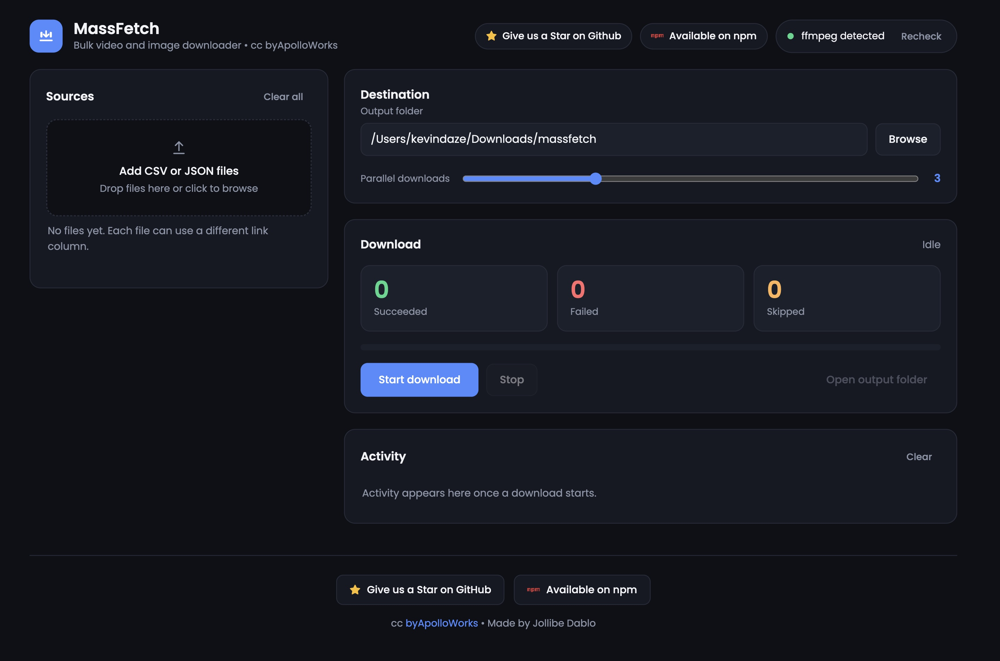

# massfetch

[](https://www.npmjs.com/package/massfetch)
[](https://github.com/byApolloWorks/massfetch)
[](LICENSE)
[](https://github.com/byApolloWorks)

Bulk video and image downloader with a clean local web interface that runs privately on your computer.

Load CSV, JSON, or plain TXT files containing links. MassFetch automatically downloads every YouTube video, Facebook video/reel, and direct image in parallel, sorts them into organized folders, and produces a complete audit report.

⭐ **[Give us a Star on GitHub](https://github.com/byApolloWorks/massfetch)** &bull; 📦 **[Available on npm](https://www.npmjs.com/package/massfetch)** &bull; 🏢 **cc [byApolloWorks](https://github.com/byApolloWorks)**

---



---

## Highlights

- **Multi-Format Ingestion**: Drag and drop `.csv`, `.json`, or `.txt` files. Automatically detects delimiters (comma, tab, semicolon, pipe) and handles multiple file encodings (`UTF-8`, `CP1252`, `Latin-1`).
- **Smart Link Detection**: Automatically scans headers (`link`, `url`, `video`, `image`, etc.) to find target URLs without manual configuration.
- **Universal Media Engines**:
  - **YouTube**: Videos, Shorts, and playlists downloaded via `yt-dlp`.
  - **Facebook**: Public posts, videos, and reels with automatic source extraction fallback (no login or cookies needed).
  - **Images**: High-speed parallel HTTP downloading for JPG, PNG, WebP, GIF, SVG, BMP, and TIFF.
- **Parallel Downloading**: Multi-threaded download engine with in-app concurrency control (1 to 16 simultaneous streams).
- **Auto-Sorting & Reports**: Automatically categorizes finished files into `YouTube/`, `Facebook/`, and `Images/` folders, generating a timestamped `download_report_<datetime>.csv` summary.
- **Visual Folder Navigator**: Pick local destination folders directly within the interface using an interactive directory browser.
- **Zero-Config Setup**: Automatically detects Python 3.9+ and provisions a private, isolated virtual environment without touching your system Python packages.
- **1-Click Desktop Launcher**: Optional native launcher creation for macOS (`MassFetch.app`), Windows (Desktop & Start Menu shortcuts), and Linux (`.desktop` entries).
- **Local & Secure**: Binds strictly to `127.0.0.1` with DNS-rebinding protection. Your links and files never leave your computer.

## Requirements

- [Node.js](https://nodejs.org) 16 or newer
- [Python](https://www.python.org/downloads/) 3.9 or newer
- [ffmpeg](https://ffmpeg.org) (optional, recommended for best quality video and audio merging)

### Installing ffmpeg (optional)

| System  | Command                   |
| ------- | ------------------------- |
| Mac     | `brew install ffmpeg`     |
| Windows | `winget install ffmpeg`   |
| Linux   | `sudo apt install ffmpeg` |

*Without ffmpeg, videos download with audio at standard resolution.*

## Installation

Install globally via npm:

```bash
npm install -g massfetch
```

## Quick Start

1. Start the application:
   ```bash
   massfetch
   ```
2. Your browser opens `http://127.0.0.1:5757`. The first run builds the private Python environment in under a minute; subsequent runs start instantly.
3. Drop your `.csv`, `.json`, or `.txt` files into the **Sources** panel.
4. Verify or adjust the detected **Link column** and choose an **Output folder**.
5. Click **Start download**.
6. When complete, click **Open output folder** to view your sorted downloads and report.

To exit, return to your terminal and press `Ctrl+C`.

## Desktop Launcher

Create desktop and application menu shortcuts for one-click access:

```bash
massfetch --install-launcher
```

To remove them:

```bash
massfetch --uninstall-launcher
```

## Supported File Formats

### 1. Plain Text (`.txt`)
One link per line. Comments (starting with `#` or `//`) and blank lines are automatically ignored:
```text
# YouTube links
https://www.youtube.com/watch?v=dQw4w9WgXcQ
https://youtu.be/kJQP7kiw5Fk

# Facebook & Images
https://www.facebook.com/reel/123456789
https://example.com/photo.jpg
```

### 2. CSV (`.csv`)
Comma, tab, or semicolon separated with a header row:
```csv
title,link
First video,https://www.youtube.com/watch?v=abc123
Second video,https://www.facebook.com/reel/123456
Photo,https://example.com/photo.jpg
```

### 3. JSON (`.json`)
A top-level list of objects or an object containing a list:
```json
[
  { "title": "First video", "link": "https://youtu.be/abc123" },
  { "title": "Photo", "link": "https://example.com/photo.jpg" }
]
```

## Command Line Options

| Command                          | Description                                       |
| -------------------------------- | ------------------------------------------------- |
| `massfetch`                      | Start the server and open your browser            |
| `massfetch --port <number>`      | Run on a custom port (default: `5757`)            |
| `massfetch --no-open`            | Start server without launching the browser        |
| `massfetch --update`             | Update `yt-dlp` to latest release, then start     |
| `massfetch --doctor`             | Diagnostics check for Node, Python, and ffmpeg    |
| `massfetch --reset`              | Rebuild the isolated Python virtual environment   |
| `massfetch --install-launcher`   | Create desktop and app menu shortcuts             |
| `massfetch --uninstall-launcher` | Remove shortcuts and desktop entries              |
| `massfetch -v, --version`        | Print version                                     |
| `massfetch -h, --help`           | Display help information                          |

## Troubleshooting

- **Downloads fail or video sites changed**: Run `massfetch --update`. Media extractors update frequently.
- **Private posts**: Facebook videos must be public; MassFetch does not require or store user credentials.
- **Custom Python executable**: Set the `MASSFETCH_PYTHON` environment variable to your Python binary path if it is not found automatically.
- **Linux venv creation**: Ensure python3-venv is installed: `sudo apt install python3-venv`.
- **System checks**: Run `massfetch --doctor` to verify your environment status.

## Project Structure

```
bin/massfetch.js      Node.js CLI runner (manages Python venv & lifecycle)
lib/python.js         Python discovery and automated virtualenv setup
lib/launcher.js       Native desktop shortcut installer (macOS, Windows, Linux)
python/core.py        Parallel download engine (yt-dlp, requests, classifier)
python/server.py      Lightweight Flask server & JSON API (localhost only)
python/static/        Frontend interface (HTML5, Vanilla CSS, Vanilla JS, SVG)
```

## License

MIT &bull; Copyright (c) 2026 byApolloWorks, Jollibe Dablo. See [LICENSE](LICENSE).
